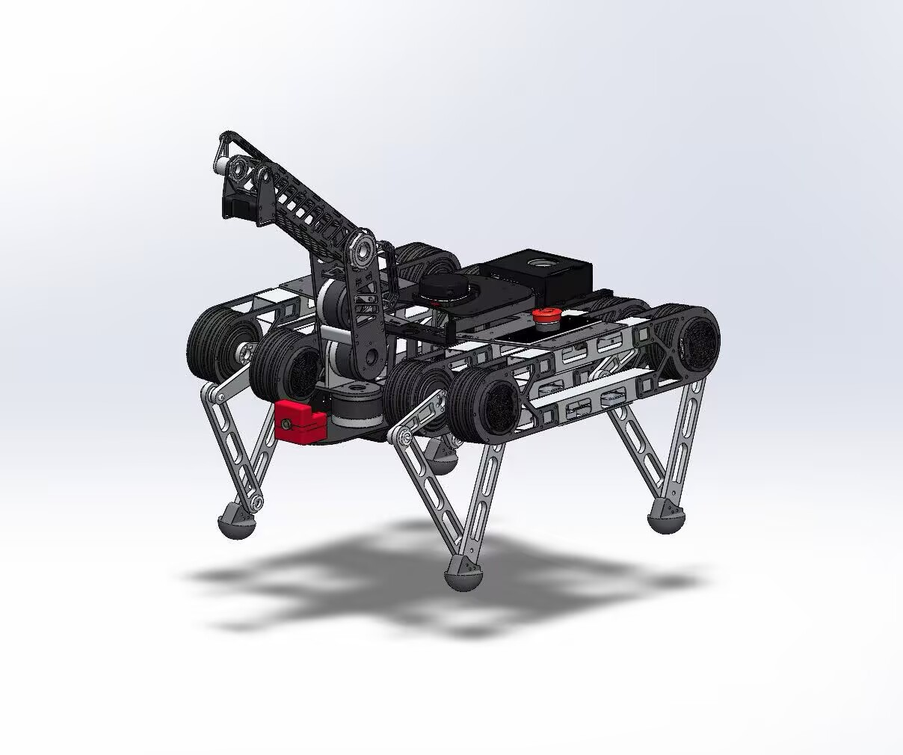

# ROBOCON2026\-8009DOG

> 苏州工学院 2026赛季足式机器人（一队）项目开源
> 
> 

## 简介

本仓库是**苏州工学院 ROBOCON 2025 足式机器人一队**的机械、软件、部分硬件、控制方案与配套资料归档整理。

2026赛季成绩：**两项项目均获得全国三等奖（国三）**

主体代码框架沿用上赛季二队：https://github.com/Childhood-zml/ROBOCON2025-8009DOG

迭代部分：

- 在25赛季基础上重写 DT7 遥控解析，以 50 ms 非阻塞消抖、死区、CH4 转向锁定与急停替代原 500 ms 阻塞确认；修正 12 位速度/力矩反馈符号扩展并在 MIT 打包前逐项钳位，统一 CAN 句柄入参。

- 新增关节线圈温度监测（100 ℃ 报警失能 / 80 ℃ 解除）与跳跃四段时序分段增益，按装配方向重排 8 关节横滚补偿符号，电机任务周期 3 ms → 2 ms，并搭建位置—速度串级双环框架（反馈接线待收尾）。

- 特别说明：因后期一些原因，机械臂部分并未调试，与视觉导航也并未联动，任务赛时只有相关机构

## 演示

b站：

- [仿生足式机器人爆炸视图](https://www.bilibili.com/video/BV1cCEw64E4G/?spm_id_from=333.1391.0.0&vd_source=4f07d0682bac8028161eae946482de58)

- [仿生足式机器人运动视频](https://www.bilibili.com/video/BV1cyEw6dEKj/?spm_id_from=333.1391.0.0&vd_source=4f07d0682bac8028161eae946482de58)

图片直播：

- [https://alltuu\.cc/album/73a32108739142c368e1fa39230fa9c4/?menu=live](https://m/)

## 仓库目录结构
| 目录 | 说明 |
| --- | --- |
| `1.Hardware/` | 机械图纸以及布线图片|
| `2.Software/` | 完全下位机（STM32F427，Keil uVision 工程：robohorse2022.uvprojx |
| `3.Document/` | 模块资料与手册（PDF） |
| `3.Picture/` | 比赛图片 |
| `assets/` | README 图片素材 |

## 快速开始

### 下位机 Keil 工程

打开 [`2.Software/project_8009_2026/robohorse2022/MDK-ARM/robohorse2022.uvprojx`](https://github.com/Childhood-zml/ROBOCON2026-8009DOG/blob/main/2.Software/project_8009_2026/robohorse2022/MDK-ARM/robohorse2022.uvprojx)

> 环境建议：Keil uVision5，适配 STM32F427 芯片，配套 DM 8009 电机驱动
> 
> 

## 重要声明

由于本人2026赛季电控方向成员，部分原始设计文档、调试日志、内部说明存在缺失，资料排布也可能不够规整，敬请谅解。 如果有疑问，欢迎在 Issue 中交流讨论。

## 致谢 \& 参考开源

项目方案参考（在此特别感谢宁波工程学院的开源）：

- [https://gitee\.com/Ha\-WthorN/robocon\-nbut](https://gitee.com/Ha-WthorN/robocon-nbut)

- [https://gitlab\.com/nbutroboticslab/Competition\_Projects/robocon/robocon2022](https://gitlab.com/nbutroboticslab/Competition_Projects/robocon/robocon2022)

仓库文档框架参考：

- [https://blog\.csdn\.net/weixin\_52612260/article/details/134124028](https://blog.csdn.net/weixin_52612260/article/details/134124028)

- [https://blog\.csdn\.net/Hbutneymar/article/details/147161479](https://blog.csdn.net/Hbutneymar/article/details/147161479)

资料参考：

- [【必读】LocoWiki介绍](https://lain-database.feishu.cn/wiki/HwyJwB70niKbW7khmwlcbCH2nXb)

## 许可声明

本仓库当前未附带 `LICENSE` 文件；如需在论文/商业项目中使用，请先联系作者确认授权范围。

